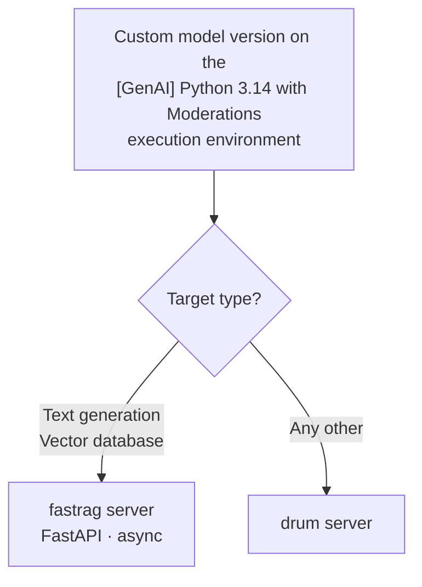

# How a GenAI custom model is served

FastRAG is the default server for LLM and vector database custom models on DataRobot. There is no flag to turn on.

- Text generation and vector database models start `fastrag server`. Sync `custom.py` hooks still work: FastRAG runs them in a thread pool. Make them `async` to get the throughput benefit.
- Other target types on this environment still start DRUM.
- A model version keeps the execution environment version it was created with. A deployment on an older environment version that has no FastRAG keeps running DRUM.
- To move such a deployment to FastRAG, create a new model version on the current version of the environment and deploy it.
